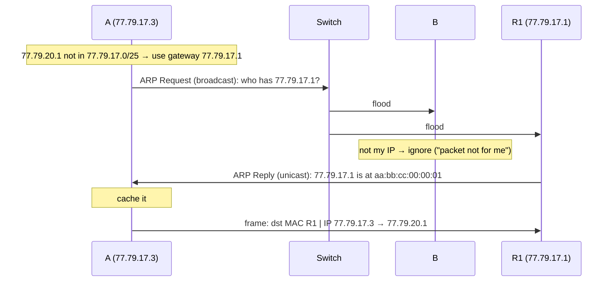
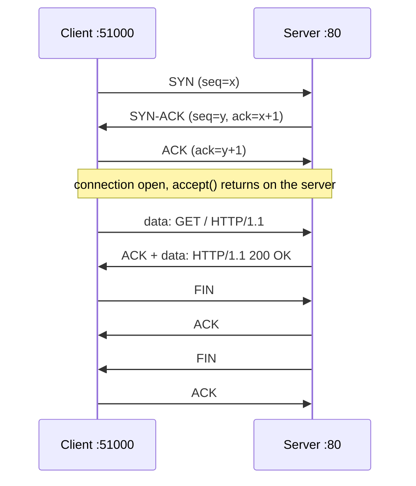

# NetPractice — The Complete Guide

> From "what is an IP address?" to solving all 10 levels, and from there to **webserv** and **ft_irc**.

NetPractice is a 10-level networking exercise. Each level shows a small network that does not work; you fix **IP addresses, masks and routes** until every goal shows **OK**. Run it with `./run.sh` and open the printed URL.

This guide is written in the order you should learn it:

```
 Part 1: Foundations          Part 2: NetPractice        Part 3: Beyond
 ─────────────────────        ───────────────────        ──────────────
 how networks work     ───►   apply it, level by   ───►  webserv & ft_irc
 (layers, IP, routing)        level, with our real       (sockets, HTTP, IRC)
                              mistakes and fixes
```

> **New to networking?** Start with the [ROADMAP](ROADMAP.md): a step-by-step path from the basics to subnetting, routing, webserv/ft_irc and on to BGP. Come back here when a stage points you to a section.

> **About the numbers:** values are randomized per login. Examples use the values from our own sessions (logins `bnj` and `zhaouzan`). Replace them with yours. The **method** is what matters.

---

## Table of contents

**Part 1: Foundations**
1. [The big picture: OSI and TCP/IP](#1-the-big-picture-osi-and-tcpip)
2. [How a message travels: encapsulation](#2-how-a-message-travels-encapsulation)
3. [Inside the packet: what each layer adds](#3-inside-the-packet-what-each-layer-adds)
4. [Layer 2: MAC, switches and ARP](#4-layer-2-mac-switches-and-arp)
5. [Layer 3: IP addressing and subnetting](#5-layer-3-ip-addressing-and-subnetting)
6. [Layer 3: routing](#6-layer-3-routing)
7. [Layer 3+4: NAT](#7-layer-34-nat)
8. [Layer 4: ports, TCP and UDP](#8-layer-4-ports-tcp-and-udp)
9. [Other protocols you will meet](#9-other-protocols-you-will-meet)
10. [Full journey: A opens a web page on C](#10-full-journey-a-opens-a-web-page-on-c)

**Part 2: NetPractice**

11. [How the simulator decides](#11-how-the-simulator-decides)
12. [Method for any level](#12-method-for-any-level)
13. [Levels 1–10: lesson, solution, our mistakes](#13-levels-110)
14. [Mistake cheat sheet](#14-mistake-cheat-sheet)
15. [Evaluation](#15-evaluation)

**Part 3: Beyond NetPractice**

16. [From NetPractice to webserv and ft_irc](#16-from-netpractice-to-webserv-and-ft_irc)
17. [Try it on your own machine](#17-try-it-on-your-own-machine)

**Part 4: Resources**

18. [Videos, guides, books and RFCs](#18-resources)

---

# Part 1: Foundations

## 1. The big picture: OSI and TCP/IP

A network model splits communication into **layers**. Each layer does one job, uses the layer below, and serves the layer above. NetPractice only lets you edit **layer 3** (IP addresses, masks, routes), but every packet in it crosses all the layers.

| # | OSI layer | TCP/IP layer | Job | Address / unit | Devices & examples | Read more |
| --- | --- | --- | --- | --- | --- | --- |
| 7 | Application | Application | What the program says | data / message | HTTP, IRC, DNS, SSH | [§16](#16-from-netpractice-to-webserv-and-ft_irc) |
| 6 | Presentation | Application | Format, encoding, encryption | data | UTF-8, JSON, TLS | — |
| 5 | Session | Application | Open / keep / close a conversation | data | sessions, TLS handshake | — |
| 4 | Transport | Transport | Program-to-program delivery | **port** / segment | TCP, UDP | [§8](#8-layer-4-ports-tcp-and-udp) |
| 3 | Network | Internet | Host-to-host across networks | **IP address** / packet | **router**, IP, ICMP | [§5](#5-layer-3-ip-addressing-and-subnetting), [§6](#6-layer-3-routing) |
| 2 | Data link | Link | Delivery on one local network | **MAC address** / frame | **switch**, Ethernet, ARP | [§4](#4-layer-2-mac-switches-and-arp) |
| 1 | Physical | Link | Bits on a medium | bits | cable, fibre, radio | [§3](#3-inside-the-packet-what-each-layer-adds) |

- **OSI** (7 layers) is the teaching and reference model.
- **TCP/IP** (4 layers) is what the Internet actually runs. It merges OSI 5–7 into *Application* and 1–2 into *Link*.
- Mnemonic, layer 1 → 7: **P**lease **D**o **N**ot **T**hrow **S**ausage **P**izza **A**way.

### Where NetPractice fits

| NetPractice element | Layer | Why |
| --- | --- | --- |
| Cable between two devices | 1 | carries the bits |
| Switch | 2 | forwards frames inside **one** network; has no IP, so you never configure it |
| IP address + mask on an interface | 3 | identifies the host and its network |
| Router | 3 | joins **different** networks, reads the destination IP, picks an interface or route |
| Routing table, `default`, gateway | 3 | decides the next hop |
| Internet cloud | 3 | a chain of routers you cannot configure |
| Goal "A reaches B" | 3 | tests IP connectivity, like `ping` |

The layers explain the game's rules:

- Hosts on one switch need the **same network**: a switch works at layer 2 and cannot route between networks. → [§4](#4-layer-2-mac-switches-and-arp)
- Leaving your network needs a **router + route**: crossing networks is a layer 3 job. → [§6](#6-layer-3-routing)
- The **gateway must be on your own cable**: the host finds the router's MAC with ARP, and ARP only works on the local network. → [ARP](#arp)
- Private IPs fail toward the Internet: real networks fix this with NAT, NetPractice has none. → [§7](#7-layer-34-nat)

---

## 2. How a message travels: encapsulation

Each layer **wraps** the data from the layer above with its own header. The receiver unwraps in reverse order.

```
Application   [ GET /index.html HTTP/1.1 ]                       data
Transport     [ TCP hdr: src port 51000 → dst port 80 ][ data ]  segment
Network       [ IP hdr: 77.79.17.3 → 77.79.20.1 ][ segment ]     packet
Data link     [ Eth hdr: MAC A → MAC R1 ][ packet ][ FCS ]       frame
Physical      0101100101110...                                   bits
```

**Key idea:** at every router the **layer 2 header is replaced** (new MACs for the next cable), while the **layer 3 header stays the same** (same source and destination IP; only the TTL goes down). That is what the NetPractice logs show: the destination IP never changes while the packet moves gateway to gateway.

<a id="packet-vs-frame"></a>
### Packet vs frame: the exact difference

Each name means "this layer's header + everything it carries":

| Name (PDU) | Layer | = | Addressed by | Lives for |
| --- | --- | --- | --- | --- |
| Data / message | 7 | application bytes | — | end to end |
| **Segment** (TCP) / datagram (UDP) | 4 | L4 header + data | ports | end to end |
| **Packet** | 3 | IP header + segment | IP addresses | **end to end**, across every router |
| **Frame** | 2 | Ethernet header + packet + FCS trailer | MAC addresses | **one cable / one local network** |
| Bits | 1 | the frame as a signal, plus preamble | — | the wire |

**Packet (layer 3)**
- Starts with the **IP header**: source IP, destination IP, TTL, protocol.
- Built once by the sender, kept until the destination. Routers read it but don't replace it (they only lower the TTL and update the checksum).
- No trailer. Max size = MTU (1500 bytes on Ethernet).

**Frame (layer 2)**
- **Wraps the packet**: Ethernet header (MACs, EtherType) before it, **FCS** checksum after it. The frame is the only unit with a **trailer**.
- Lives on **one link only**. Each router removes the frame, reads the packet, and builds a **brand-new frame** for the next cable.
- Switches work with frames; routers work with packets.

**Example, level 9, A → C: one packet, three different frames.**

```
            frame #1                 frame #2                 frame #3
A ──────────────────── R1 ────────────────────── R2 ────────────────────── C
  MAC A → MAC R11          MAC R13 → MAC R21         MAC R22 → MAC C
  ┌────────────────────┐   ┌────────────────────┐    ┌────────────────────┐
  │ IP 77.79.17.3 →    │   │ IP 77.79.17.3 →    │    │ IP 77.79.17.3 →    │
  │    77.79.20.1      │   │    77.79.20.1      │    │    77.79.20.1      │
  │ TTL 64             │   │ TTL 63             │    │ TTL 62             │
  └────────────────────┘   └────────────────────┘    └────────────────────┘
        same packet (only TTL/checksum change)
```

> **In one sentence:** the **packet** says *where it's finally going* (IP, end to end); the **frame** says *who gets it next on this wire* (MAC, one hop).

People often say "packet" for everything, Wireshark included. In NetPractice everything happens at layer 3, so "packet" is correct there.

### Building it (sender, top → down)

| Step | Layer | Done by | Adds |
| --- | --- | --- | --- |
| 1 | 7 | your program (`send()`) | HTTP or IRC text |
| 2 | 4 | kernel TCP | ports, sequence/ack, flags, checksum → **segment** |
| 3 | 3 | kernel IP | IPs, TTL, protocol → **packet**; reads the **routing table** to choose interface and gateway ([§6](#6-layer-3-routing)) |
| 4 | 2 | kernel + network card driver | [ARP](#arp) finds the gateway's MAC; adds MACs, EtherType, FCS → **frame** |
| 5 | 1 | network card | preamble + bits on the wire |

### Reading it (receiver, bottom → up)

| Step | Layer | Check | If it fails |
| --- | --- | --- | --- |
| 1 | 1 | sees the preamble, turns signal into bits | nothing received |
| 2 | 2 | destination MAC = mine (or broadcast)? FCS OK? EtherType → IPv4 | frame dropped |
| 3 | 3 | checksum OK? destination IP = mine? Protocol → TCP | not mine: a **router** forwards it (TTL − 1, new frame); a host drops it, which is NetPractice's `packet not for me` |
| 4 | 4 | checksum OK? find the socket by the 4-tuple; reorder by sequence; send ACK | no program listening → `RST` ("connection refused") |
| 5 | 7 | bytes wait in the socket buffer until the program calls `recv()` | — |

### How far each device opens the packet

| Device | Reads up to | Changes |
| --- | --- | --- |
| Hub / cable | layer 1 | nothing |
| Switch | layer 2 (MAC) | nothing; learns which MAC is on which port |
| Router | layer 3 (IP) | new MACs, TTL − 1, IP checksum |
| NAT router / firewall | layer 4 (ports) | may rewrite IP and port ([§7](#7-layer-34-nat)) |
| Host / server | layer 7 | final destination; the program reads the data |

---

## 3. Inside the packet: what each layer adds

A full Ethernet frame carrying an HTTP request:

```
┌──────────┬──────────────┬──────────────┬────────────────────────┬─────┐
│ Ethernet │  IP header   │  TCP header  │   HTTP data (payload)  │ FCS │
│  14 B    │   20 B       │   20 B       │   e.g. 78 B            │ 4 B │
└──────────┴──────────────┴──────────────┴────────────────────────┴─────┘
 Layer 2      Layer 3        Layer 4          Layer 7               Layer 2
 │◄──────────────────────── frame (136 B) ─────────────────────────────►│
            │◄────────────── IP packet (118 B) ──────────────►│
                           │◄──── TCP segment (98 B) ────────►│
```

Each header has a field that says **what is inside the next layer**. This is how the receiver knows who to hand the data to (demultiplexing):

| Layer | Field | Value → meaning |
| --- | --- | --- |
| 2 Ethernet | EtherType | `0x0800` IPv4 · `0x0806` ARP · `0x86DD` IPv6 |
| 3 IP | Protocol | `1` ICMP · `6` TCP · `17` UDP |
| 4 TCP/UDP | Destination port | `80` HTTP · `443` HTTPS · `6667` IRC · `53` DNS |

### Layer 1: Physical (bits)

Not a header but a signal: electrical, light or radio. Before each frame comes a **preamble** (7 bytes `10101010…`) and a **Start Frame Delimiter** (1 byte) so the receiver can sync its clock.

### Layer 2: Ethernet II frame (14-byte header + 4-byte trailer)

| Field | Size | Content | Example |
| --- | --- | --- | --- |
| Destination MAC | 6 B | next device on **this** cable | R1 `aa:bb:cc:00:00:01` |
| Source MAC | 6 B | sender on this cable | A `3c:22:fb:12:ab:9e` |
| (802.1Q VLAN tag) | 4 B | optional, VLAN ID | — |
| EtherType | 2 B | what's inside | `0x0800` (IPv4) |
| Payload | 46–1500 B | the IP packet | — |
| FCS | 4 B | CRC-32 of the frame | detects corruption |

- Max payload = **MTU 1500 bytes**; frames are 64 to 1518 bytes.
- Broadcast MAC `ff:ff:ff:ff:ff:ff` = everyone on the local network (used by [ARP](#arp)).

### Layer 3: IPv4 header (20 bytes, up to 60)

```
 0                   1                   2                   3   (bits)
 0 1 2 3 4 5 6 7 8 9 0 1 2 3 4 5 6 7 8 9 0 1 2 3 4 5 6 7 8 9 0 1
+-------+-------+-----------+---+-------------------------------+
|Version|  IHL  |   DSCP    |ECN|         Total Length          |
+-------+-------+-----------+---+-----+-------------------------+
|        Identification         |Flags|     Fragment Offset     |
+---------------+---------------+-----+-------------------------+
|      TTL      |   Protocol    |        Header Checksum        |
+---------------+---------------+-------------------------------+
|                       Source IP Address                       |
+---------------------------------------------------------------+
|                    Destination IP Address                     |
+---------------------------------------------------------------+
|                    Options (rare, optional)                   |
+---------------------------------------------------------------+
```

| Field | Size | Role | Example |
| --- | --- | --- | --- |
| Version | 4 bits | `4` for IPv4 | 4 |
| IHL | 4 bits | header length in 32-bit words | 5 (= 20 B) |
| DSCP / ECN | 8 bits | priority, congestion signal | 0 |
| Total Length | 16 bits | header + data | 118 |
| Identification, Flags, Fragment Offset | 32 bits | rebuilding split packets; `DF` = don't fragment | DF=1 |
| TTL | 8 bits | hop limit: −1 per router, dropped at 0 | 64 |
| Protocol | 8 bits | what's inside | 6 (TCP) |
| Header Checksum | 16 bits | protects the header; recomputed every hop | — |
| Source IP | 32 bits | original sender | `77.79.17.3` |
| Destination IP | 32 bits | final target, **the field routers read** | `77.79.20.1` |

> **The mask is not in the packet.** Each device applies its own mask locally. That's why a wrong mask in NetPractice only breaks the device that has it.

### Layer 4: TCP header (20 bytes, up to 60)

| Field | Size | Role | Example |
| --- | --- | --- | --- |
| Source port | 16 bits | client's random (ephemeral) port | 51000 |
| Destination port | 16 bits | the service | 80 |
| Sequence number | 32 bits | position of this segment's first byte in the stream | 1000 |
| Acknowledgment number | 32 bits | next byte expected from the other side | 5001 |
| Data offset | 4 bits | header length | 5 (= 20 B) |
| Flags | 8 bits | `SYN` open · `ACK` · `FIN` close · `RST` abort · `PSH` · `URG` · `ECE` · `CWR` | `PSH, ACK` |
| Window | 16 bits | bytes the receiver can accept (flow control) | 64240 |
| Checksum | 16 bits | protects header + data | — |
| Urgent pointer | 16 bits | rarely used | 0 |
| Options | 0–40 B | MSS, window scale, SACK, timestamps | MSS 1460 |

- **MSS** = MTU 1500 − IP 20 − TCP 20 = **1460 bytes**. A large response is split into many segments, which is why `recv()` in webserv/ft_irc returns partial data. → [§16](#16-from-netpractice-to-webserv-and-ft_irc)
- How TCP uses these fields (handshake, close): → [§8](#8-layer-4-ports-tcp-and-udp)

### Layer 4 alternative: UDP header (8 bytes)

| Source port | Destination port | Length | Checksum |
| --- | --- | --- | --- |
| 16 bits | 16 bits | 16 bits | 16 bits |

No sequence numbers, no ACKs, no connection.

### Layers 5–7: application data

Just the bytes the program writes with `send()`:

```
GET /index.html HTTP/1.1\r\n
Host: 77.79.20.1\r\n
\r\n
```

or for IRC: `PRIVMSG #chan :hello\r\n`. With HTTPS, TLS (layer 6) encrypts these bytes before TCP sends them.

---

## 4. Layer 2: MAC, switches and ARP

### MAC vs IP address

| | MAC address (L2) | IP address (L3) |
| --- | --- | --- |
| Example | `3c:22:fb:12:ab:9e` | `77.79.17.3` |
| Size | 48 bits | 32 bits (IPv4) |
| Given by | burned into the network card | configuration or DHCP |
| Scope | one local network | end to end, across routers |
| Changes per hop? | yes | no (unless [NAT](#7-layer-34-nat)) |
| Found with | ARP (IP → MAC) | DNS (name → IP) |

### Switch

- Has **no IP**. It learns which MAC sits behind which port and forwards frames there.
- Unknown destination or broadcast → **floods** to all ports. That's what NetPractice shows as `pass to all connections`, followed by `packet not for me` and `loop detected` on the other hosts. **Both lines are normal.**
- Everything on one switch = **one network, one mask** (NetPractice level 3).

<a id="arp"></a>
### ARP: finding the MAC for an IP

**Problem:** IP decides *which* device the packet goes to next (the host itself, or the gateway). But the frame needs a **MAC address**. ARP (RFC 826) asks: *"Who has IP X? Tell me your MAC."*

ARP uses broadcast, and routers don't forward broadcasts, so **ARP only works inside one local network**. This is the real reason behind the NetPractice rule *"the gateway must be on your own network"*.

**Level 9 example: A sends to C.** A = `77.79.17.3`, gateway R11 = `77.79.17.1`, C = `77.79.20.1`.



The **destination IP is C**, but the **destination MAC is R1**. A never learns C's MAC and doesn't need it. ARP runs again on every cable:

| Hop | Cable (network) | ARP question | Frame MACs | IP header |
| --- | --- | --- | --- | --- |
| A → R1 | 77.79.17.0/25 | who has 77.79.17.1? | A → R11 | 77.79.17.3 → 77.79.20.1 |
| R1 → R2 | 77.79.18.252/30 | who has 77.79.18.254? | R13 → R21 | unchanged |
| R2 → C | 77.79.20.0/24 | who has 77.79.20.1? | R22 → C | unchanged |

**ARP message** (EtherType `0x0806`, carried directly in a frame, no IP header):

| Field | Request | Reply |
| --- | --- | --- |
| Opcode | 1 | 2 |
| Sender MAC | A's MAC | R1's MAC |
| Sender IP | 77.79.17.3 | 77.79.17.1 |
| Target MAC | 00:00:00:00:00:00 (unknown) | A's MAC |
| Target IP | 77.79.17.1 | 77.79.17.3 |

**Good to know**
- **Cache:** answers are kept for a while. See yours with `ip neigh`.
- **Gratuitous ARP:** a device announces its own IP/MAC unasked. It helps detect **duplicate IPs**, NetPractice's `duplicate IP` error.
- **Security:** ARP has no authentication; fake replies ("I am the gateway") = **ARP spoofing**, a man-in-the-middle attack.
- **IPv6** replaces ARP with NDP (Neighbor Discovery).
- **Loopback:** traffic to `127.0.0.1` (your webserv/ft_irc tests) never touches a network card, so there is no ARP and no Ethernet.

---

## 5. Layer 3: IP addressing and subnetting

### IP and mask

- An IPv4 address = 32 bits = 4 octets (0–255).
- The **mask** splits it: `1` bits = network part, `0` bits = host part.
- `255.255.255.0` = `/24`. Same thing, two notations.
- Two interfaces talk directly only if they are in the **same network with the same mask**. (Level 1)

### Block size

Block size = `256 − (first mask octet that is not 255)`, counted in **that** octet.

| CIDR | Mask | Block | Usable hosts | Seen in |
| --- | --- | --- | --- | --- |
| /16 | 255.255.0.0 | 256 in 3rd octet | 65 534 | level 1 |
| /18 | 255.255.192.0 | 64 in 3rd octet | 16 382 | levels 5, 9 |
| /24 | 255.255.255.0 | 256 | 254 | level 1 |
| /25 | 255.255.255.128 | 128 | 126 | levels 3, 5, 6, 9, 10 |
| /26 | 255.255.255.192 | 64 | 62 | levels 4, 8, 10 |
| /27 | 255.255.255.224 | 32 | 30 | level 2 |
| /28 | 255.255.255.240 | 16 | 14 | levels 8, 10 |
| /29 | 255.255.255.248 | 8 | 6 | — |
| /30 | 255.255.255.252 | 4 | 2 | levels 2, 7, 8, 9, 10 |

### Network and broadcast address

Example: `.222` with `/27` (block 32)

1. `222 ÷ 32 = 6.9` → network = `6 × 32 = .192`
2. Broadcast = `192 + 32 − 1 = .223`
3. Usable = `.193` – `.222`

Same rule one octet to the left: `145.27.210.254 /18` → block 64 in the 3rd octet → 210 is in `192–255` → network `145.27.192.0`, broadcast `145.27.255.255` (level 5).

> **Network and broadcast addresses can never be given to an interface.**
> With `/30`, block `.252–.255`: only `.253` and `.254` are usable. (Our level 9 mistake: [§13](#level-9))

### Addresses you cannot use

| Range | Why |
| --- | --- |
| `127.0.0.0/8` | loopback: the machine itself (level 2, 3) |
| first octet `0` or above `223` | reserved / multicast |
| network and broadcast of each subnet | see above |
| `10.0.0.0/8`, `172.16.0.0/12`, `192.168.0.0/16` | **private**: fine inside, **dropped by the Internet** (levels 8, 9) → [§7 NAT](#7-layer-34-nat) |

### Subnetting: splitting one range

Give each cable its own range and make sure **no two interfaces of the same router overlap**. Level 10 as an example:

```
.0 ─── .127 | .128 ─ .191 | .192 ─ .207 | .208….251 | .252 ─ .255
 switch     |  H4 side    |  H3 side    |   free    |  R1–R2 link
   /25      |    /26      |    /28      |           |    /30
```

---

## 6. Layer 3: routing

### Devices

| Device | Role |
| --- | --- |
| Host | one interface + one route (`default` → its router) |
| Switch | no IP, one network ([§4](#4-layer-2-mac-switches-and-arp)) |
| Router | one interface per network; interfaces **must never overlap** |
| Internet | you only edit its routes back to you; it refuses a `default` route |

### Routes

- Route = **destination network** + **gateway** (next hop).
- `default` = `0.0.0.0/0` = everything.
- Destination field: `network/mask` → `77.79.20.0/24`.
- Gateway field: **one IP, no mask** → `77.79.18.254`.
- Gateway = a neighbour router's IP **on your own cable** (because of [ARP](#arp)).
- A device never needs a route to a network it's directly connected to.

### How a router decides

```
1. Is the destination in one of MY networks?  → send out that interface, done
2. Otherwise read routes, top to bottom      → FIRST match wins
3. No match                                  → drop ("destination does not match any route")
```

Put **specific routes first and `default` last**, pointing to the exit (the Internet). A `default` at the top hides every route below it. That was our level 9 mistake.

### TTL and loops

Each router subtracts 1 from the TTL; at 0 the packet is dropped. This stops packets from circling forever when two routers point their defaults at each other (NetPractice: `loop detected`).

---

## 7. Layer 3+4: NAT

**Problem:** IPv4 has about 4.3 billion addresses, not enough for every device. Homes and companies use **private addresses**, but the Internet **drops** private destinations, exactly like NetPractice levels 8–9.

**Solution:** NAT (Network Address Translation) on the border router **rewrites addresses** as packets cross it. Inside: private IPs. Outside: everyone appears as the router's **one public IP**. The common form, **PAT / NAPT** (what every home box does), also rewrites **ports** to tell inside devices apart.

### How it works (level 8 topology, *if* NetPractice had NAT)

Inside: C = `192.168.0.1`, D = `192.168.0.20`. R1's public interface = `163.189.250.12`. Both open a page on `93.184.216.34:80`.

```
C sends:      src 192.168.0.1:51000    → dst 93.184.216.34:80
R1 rewrites:  src 163.189.250.12:40001 → dst 93.184.216.34:80

D sends:      src 192.168.0.20:51000   → dst 93.184.216.34:80
R1 rewrites:  src 163.189.250.12:40002 → dst 93.184.216.34:80
```

**NAT table on R1:**

| Inside (private) | Outside (public) | Remote | Protocol |
| --- | --- | --- | --- |
| 192.168.0.1:51000 | 163.189.250.12:40001 | 93.184.216.34:80 | TCP |
| 192.168.0.20:51000 | 163.189.250.12:40002 | 93.184.216.34:80 | TCP |

**Return:** the server only saw `163.189.250.12`. R1 looks up the port and rewrites back:

```
Server replies: 93.184.216.34:80 → dst 163.189.250.12:40002
R1 rewrites:    93.184.216.34:80 → dst 192.168.0.20:51000   → delivered to D
```

So the **Internet never needs a route to the private network**. NetPractice has no NAT, so you must give Internet-facing hosts public IPs and add Internet routes back to them by hand.

### What NAT changes

| Layer | Field | Changed? |
| --- | --- | --- |
| 2 | MACs | yes (normal at every router) |
| 3 | source IP (out) / destination IP (back) | **yes** |
| 3 | IP checksum | recomputed |
| 4 | source port (out) / destination port (back) | **yes** (PAT) |
| 4 | TCP/UDP checksum | recomputed |
| 7 | data | no (except protocols like FTP that carry IPs inside the data) |

### Types of NAT

| Type | Rewrites | Use |
| --- | --- | --- |
| Static NAT (1:1) | one private ↔ one public IP | a server with its own public IP |
| Dynamic NAT | private IPs ↔ a pool of public IPs | rare today |
| **PAT / NAPT** (many:1) | many private IP:port ↔ one public IP | every home router |
| **Port forwarding** (DNAT) | public IP:port → fixed private IP:port | hosting webserv or IRC at home |
| CGNAT | the ISP NATs you again (`100.64.0.0/10`) | mobile networks, some ISPs |

### The limit: incoming connections

A NAT entry is created only when an inside host **starts** the connection. A new connection from outside has no entry and is dropped. To let a friend reach your webserv on `192.168.1.50:8080`, add **port forwarding** on your home router: `public_IP:8080 → 192.168.1.50:8080`.

---

## 8. Layer 4: ports, TCP and UDP

A **port** (0–65535) identifies the program on a host. A connection is identified by the 4-tuple **source IP, source port, destination IP, destination port**.

| Port | Service |
| --- | --- |
| 22 | SSH |
| 53 | DNS |
| 80 / 443 | HTTP / HTTPS |
| 6667 / 6697 | IRC / IRC over TLS |
| 8080 | common test port for webserv |

### TCP vs UDP

| | TCP | UDP |
| --- | --- | --- |
| Connection | yes: handshake before data, FIN to close | none: just send |
| Reliability | every byte ACKed, losses retransmitted | lost = gone |
| Order | guaranteed (sequence numbers) | not guaranteed |
| Data model | **byte stream**: no message boundaries | **datagrams**: each one whole or lost |
| Flow / congestion control | yes | no |
| Header | 20–60 bytes | 8 bytes |
| Speed | handshake + retransmit delays | fast, low latency |
| Broadcast / multicast | no | yes |
| Socket type | `SOCK_STREAM` | `SOCK_DGRAM` |
| Server calls | `socket` → `bind` → `listen` → `accept` → `recv`/`send` | `socket` → `bind` → `recvfrom`/`sendto` |
| Used by | HTTP/1.1, HTTP/2, HTTPS, **IRC**, SSH, SMTP | DNS, DHCP, VoIP, video, games, NTP, QUIC (HTTP/3) |

**Analogy:** TCP = a phone call (dial, answer, repeat what was missed). UDP = postcards (just post them; some arrive late, out of order, or never).

**When to pick which**
- Every byte must arrive in order (web page, file, chat, commands) → **TCP**.
- Fresh beats complete (live voice/video, game positions), or a tiny request/reply (DNS, DHCP) → **UDP**.

**Same data, two behaviours:** sending `"hello"` then `"world"`:

```
TCP: receiver may read "helloworld" in one recv(), or "hel" + "loworld"  → you must frame messages
UDP: receiver reads "hello" then "world" (each whole) — or only one, or in reverse order
```

### TCP connection life



`RST` aborts a connection at once (e.g. nothing listening on that port → "connection refused").

**Real example:** when you type a URL, the browser first sends **DNS over UDP** (one datagram to port 53, one back), then opens **HTTP over TCP** (handshake, request, response, FIN).

---

## 9. Other protocols you will meet

| Protocol | Layer | What it does | Try it |
| --- | --- | --- | --- |
| ICMP | 3 | control/error messages: echo, "unreachable", "TTL exceeded" | `ping 8.8.8.8`, `traceroute 8.8.8.8` |
| DHCP | 7 (over UDP) | gives hosts IP, mask, gateway, DNS automatically | `ip addr` after joining Wi-Fi |
| DNS | 7 (UDP, sometimes TCP) | names → IP addresses | `dig example.com`, `nslookup` |
| TLS | 6 | encryption for HTTPS, IRC over TLS | `openssl s_client -connect example.com:443` |
| IPv6 | 3 | 128-bit addresses (`2001:db8::1`), same routing ideas, no NAT needed | `ip -6 addr` |

---

## 10. Full journey: A opens a web page on C

Everything from Part 1 in one trip, on the level 9 network:

1. **Application (7):** the browser on A builds `GET / HTTP/1.1`. ([§3](#3-inside-the-packet-what-each-layer-adds))
2. **Transport (4):** TCP handshake from A:51000 to C:80. ([§8](#8-layer-4-ports-tcp-and-udp))
3. **Network (3):** `77.79.20.1` is not in `77.79.17.0/25` → **default route** → gateway `77.79.17.1`. ([§6](#6-layer-3-routing))
4. **Data link (2):** ARP "who has 77.79.17.1?" → R1's MAC → frame through the switch. ([ARP](#arp))
5. **R1:** route `77.79.20.0/24 → 77.79.18.254`, TTL − 1, new frame to R2. ([packet vs frame](#packet-vs-frame))
6. **R2:** `77.79.20.1` is on its R22 interface → ARP for C → delivers.
7. **C** unwraps frame → packet → segment → the web server on port 80 answers `HTTP/1.1 200 OK`.
8. The reply takes the **reverse path**: the "Reverse way" in NetPractice.

---

# Part 2: NetPractice

## 11. How the simulator decides

Read from `js/sim.js`. Each rule links to the theory behind it:

1. A goal passes only if **forward AND reverse** paths reach the right host.
2. On each device: compare the destination with **interfaces first**; only if none matches, read routes. ([§6](#6-layer-3-routing))
3. Routes are read **top to bottom; first match wins** (no "most specific" logic). `default` must be last.
4. Two interfaces of one device matching the same address → `multiple interface match`. ([subnetting](#5-layer-3-ip-addressing-and-subnetting))
5. The gateway must be inside one of the device's own networks. ([ARP](#arp))
6. Invalid: `127.x`, first octet > 223, network or broadcast address.
7. The Internet drops private destinations and refuses a `default` route. ([NAT](#7-layer-34-nat))
8. `packet not for me` and `loop detected` around a switch are **normal flooding**, not errors. ([switch](#4-layer-2-mac-switches-and-arp))

Read the **logs panel** after **Check again**: the first red line names the device and the broken rule.

---

## 12. Method for any level

Start from what you **cannot** change, then fill in from the edges inward.

```
1. Draw cables → one network per cable, one per switch
2. ISP link (163.172.250.x) is fixed → cross that range off, never reuse it
3. List every grey (fixed) value → what network/mask/IP it forces
4. Goals with Internet → those hosts need PUBLIC IPs inside a range the Internet routes back
5. Pick one non-overlapping range per network (check each router's interfaces)
6. Assign IPs: router first, no network/broadcast, no duplicates, same mask on both ends
7. Routes: hosts (default → own router) → routers (specific nets first, default last) → Internet (your public nets)
8. Trace every goal forward + reverse; read the first red line in the logs
```

On each router, ask: *"Which networks am I NOT directly connected to, and which neighbour leads to them?"* Write one route per answer, then `default` toward the exit.

---

## 13. Levels 1–10

| Level | New idea | Theory |
| --- | --- | --- |
| 1 | same network, same mask | [§5](#5-layer-3-ip-addressing-and-subnetting) |
| 2 | ranges, CIDR, loopback | [§5](#5-layer-3-ip-addressing-and-subnetting) |
| 3 | switch | [§4](#4-layer-2-mac-switches-and-arp) |
| 4 | router interfaces don't overlap | [§6](#6-layer-3-routing) |
| 5 | routes and default gateway | [§6](#6-layer-3-routing) |
| 6 | Internet and return routes | [§6](#6-layer-3-routing), [§7](#7-layer-34-nat) |
| 7 | /30 point-to-point links | [§5](#5-layer-3-ip-addressing-and-subnetting) |
| 8 | split a public block | [§5](#5-layer-3-ip-addressing-and-subnetting), [§7](#7-layer-34-nat) |
| 9 | full network | all of Part 1 |
| 10 | deduce from fixed values | [§12](#12-method-for-any-level) |

### Level 1 — Same network

**Lesson:** two hosts on a cable must share the network part.

- A ↔ B (/24): copy B's first 3 octets to A, pick a different last octet.
- C ↔ D (/16): copy C's first 2 octets to D, any valid host part.

**Watch:** the starting values contain octets above 255.

### Level 2 — Subnet range, CIDR, loopback

**Lesson:** compute a /27 range; `/30` = `255.255.255.252`; `127.x` is unusable.

- B's mask `255.255.255.32` is invalid (bits not contiguous) → `255.255.255.224`.
- B = `.222` → range `.193–.222` → A = any of `.193–.221`.
- C/D: replace `127.x` with a pair in one /30 block, e.g. `10.0.0.1` / `10.0.0.2`.

### Level 3 — Switch

**Lesson:** a switch has no IP; everyone on it shares one network and mask.

| Host | IP | Mask |
| --- | --- | --- |
| A | 104.198.138.125 (fixed) | 255.255.255.128 |
| B | 104.198.138.12 | 255.255.255.128 |
| C | 104.198.138.14 | /25 (fixed) |

**Our confusion:** the log was full of `packet not for me` and `loop detected`. That's normal switch flooding; the level was already solved.

### Level 4 — Router interfaces must not overlap

**Lesson:** a router picks its outgoing interface by network; overlaps break it.

R2 uses `.0–.127`, R3 uses `.192–.255`, A is fixed at `.132` → the only free space is `.128–.191` = **/26** for A, B and R1.

**Our values:** R1 `123.130.116.130`, A `.132`, B `.134`, all `255.255.255.192`.

### Level 5 — First routes

**Lesson:** to leave its network a host needs a route; the gateway is the router on its own cable.

| Field | Value |
| --- | --- |
| A | 79.161.164.123 / 255.255.255.128 |
| A route | `default` → 79.161.164.126 (R1) |
| B | 145.27.211.254 / 255.255.192.0 |
| B route | `default` → 145.27.210.254 (R2) |

**Our question:** the block size of /18 → `256 − 192 = 64` in the **3rd** octet → network `145.27.192.0`.

### Level 6 — Internet

**Lesson:** routers need routes too; the Internet needs a route back to you.

| Field | Value (A = 66.231.93.227) |
| --- | --- |
| A mask | 255.255.255.128 |
| A route | `default` → 66.231.93.229 (R1) |
| R1 IP | 66.231.93.229 (any `.129–.254` except A) |
| R route | `default` → 163.172.250.1 (fixed) |
| Internet route | `66.231.93.128/25` → 163.172.250.12 (fixed) |

**Our mistake:** R's route had a bad format → `invalid route on host R`. Only `default` or `network/mask` are valid.

### Level 7 — Splitting one range into links

**Lesson:** 3 cables = 3 networks; use /30 for router links.

Mask `255.255.255.252` everywhere (X = 108):

| Link | Network | IPs |
| --- | --- | --- |
| A ↔ R1 | 108.198.14.0/30 | R11 `.1`, A `.2` |
| R1 ↔ R2 | 108.198.14.252/30 | R12 `.254`, R21 `.253` |
| R2 ↔ C | 108.198.14.4/30 | R22 `.5`, C `.6` |

| Route | Destination | Gateway |
| --- | --- | --- |
| A | default | 108.198.14.1 |
| C | default | 108.198.14.5 |
| R1 | 108.198.14.4/30 | 108.198.14.253 |
| R2 | 108.198.14.0/30 | 108.198.14.254 |

**Our mistakes:**
1. Gateways written as `108.198.14.1/30` → `invalid gate IP`. A gateway is one IP, **no mask**.
2. R2's route pointed at `.254/30` (the link itself) instead of A's network `.0/30`.
3. R2's gateway was C (`.6`) instead of R1 (`.254`).

### Level 8 — Carve a public /26

**Lesson:** private IPs can't be reached from the Internet ([§7](#7-layer-34-nat)); split the public block your ISP routes to you.

The Internet routes only `164.84.59.0/26` = `.0–.63`:

| Network | Mask | IPs |
| --- | --- | --- |
| .0/28 (C) | 255.255.255.240 | C1 `.1`, R22 `.14` |
| .16/28 (D) | 255.255.255.240 | D1 `.17`, R23 `.30` |
| .60/30 (R1–R2) | 255.255.255.252 | R13 `.62`, R21 `.61` |

| Route | Destination | Gateway |
| --- | --- | --- |
| C | 0.0.0.0/0 | 164.84.59.14 |
| D | default | 164.84.59.30 |
| R1r2 | 164.84.59.0/26 | 164.84.59.61 |
| R2 | default | 164.84.59.62 (fixed) |
| Internet | 164.84.59.0/26 (fixed) | 163.189.250.12 |

**Our mistakes:**
1. Used `192.168.0.x` → `private subnets not routed over internet`.
2. Then `.101` and `.67` → outside `.0–.63` → the Internet had no route back.
3. A /24 on the R1–R2 link would swallow the C/D subnets → must be /30.

<a id="level-9"></a>
### Level 9 — Full network

**Lesson:** plan 5 networks with no overlap, public IPs for Internet hosts, routes both ways.

| Network | Mask | IPs |
| --- | --- | --- |
| 77.79.17.0/25 (switch) | 255.255.255.128 | R11 `.1`, A `.3`, B `.2` |
| 77.79.18.252/30 (R1–R2) | 255.255.255.252 | R13 `.253`, R21 `.254` |
| 77.79.20.0/24 (C) | 255.255.255.0 | R22 `.2`, C `.1` |
| 52.58.64.0/18 (D) | /18 | R23 `52.58.100.227` (= D's fixed gateway), D `52.58.100.228` |
| 163.172.250.0/28 (ISP) | fixed | don't touch |

| Route | Destination | Gateway |
| --- | --- | --- |
| A, B | default | 77.79.17.1 |
| C | default | 77.79.20.2 |
| D | default | fixed (52.58.100.227) |
| R1r1 | 77.79.20.0/24 | 77.79.18.254 |
| R1r2 | 52.58.64.0/18 | 77.79.18.254 |
| R1r3 | default (fixed) | 163.172.250.1 |
| R2 | default (fixed) | 77.79.18.253 |
| Ir1 | 77.79.17.0/25 | 163.172.250.12 |
| Ir2 | 77.79.20.0/24 | 163.172.250.12 |

**Our mistakes (most of the session was here):**
1. Reused the ISP range `163.172.250.x` for A, B, C → duplicate IP with the Internet, overlap with R12.
2. A/B gateway = `163.172.250.1` (the Internet) instead of R11.
3. R13 `.252` = network address, R21 `.251` = broadcast of another block → `invalid IP address`.
4. C1 `.64/30` = network address, R22 `.63/30` = broadcast.
5. R2 gateway `77.79.16.254` → no interface has that IP.
6. `default` as R1's **first** route → hid every route below; real Internet traffic would loop R1 ↔ R2.
7. Typo `defaulkt` → invalid route.
8. Mask `/34` → doesn't exist (max /32) → `invalid route on host I`.
9. Left `8.8.8.8/16` (B) and `10.0.0.0/8` (D) → `destination does not match any route`.
10. Pasted an old config → fixes lost. Always check with **Get my config**.

### Level 10 — Fill the gaps

**Lesson:** most values are fixed; find the free space and fit your network into it.

```
.0 ─── .127 | .128 ─ .191 | .192 ─ .207 | .208….251 | .252 ─ .255
 H1,H2,R11  |  H4, R23    |  H3, R22    |   free    |  R13, R21
   /25      |    /26      |    /28      |           |    /30
```

| Field | Value (N = 162.135.30) |
| --- | --- |
| H1 mask | 255.255.255.128 |
| H2 | N.3 / 255.255.255.128 |
| R13 mask | 255.255.255.252 |
| R23 | N.129 / 255.255.255.192 |
| R22 | N.193 / 255.255.255.240 |
| H3 | N.194 / 255.255.255.240, gateway N.193 |
| R1r1 | N.192/28 → N.253 (fixed) |
| Internet | N.0/24 → 163.172.250.12 |

**Our mistakes:**
1. H3 network `/26` (`.192–.255`) overlapped the R1–R2 link (`.252–.255`) → `multiple interface match` on R2. Fixed with `/28`.
2. R1r1 = `N.0/25` = R1's **own** network (useless). H3 traffic went to the Internet and looped back. Fixed with `N.192/28`.

---

## 14. Mistake cheat sheet

| Log message | Cause | Fix | Theory |
| --- | --- | --- | --- |
| `invalid IP address` | 127.x, network or broadcast address | pick a usable host | [§5](#5-layer-3-ip-addressing-and-subnetting) |
| `invalid gate IP` | gateway has `/mask` or is malformed | plain IP only | [§6](#6-layer-3-routing) |
| `invalid route on host X` | typo, mask > 32, bad format | `default` or `a.b.c.d/n` | [§6](#6-layer-3-routing) |
| `invalid default route on internet` | `default` on the Internet | harmless if another route matches first | [§7](#7-layer-34-nat) |
| `duplicate IP` | same IP as another interface | change it | [ARP](#arp) |
| `multiple interface match` | two interfaces of one router overlap | shrink a mask or move a network | [§5](#5-layer-3-ip-addressing-and-subnetting) |
| `route match but no interface for gateway` | gateway not on the device's networks | gateway = neighbour on own cable | [ARP](#arp) |
| `packet not for me` (not on a switch) | gateway IP isn't on the next device | match the gateway to that interface | [§6](#6-layer-3-routing) |
| `destination does not match any route` | no route covers the destination | add/fix the route or use `default` | [§6](#6-layer-3-routing) |
| `private subnets not routed over internet` | private IP needs the Internet | use public IPs | [§7](#7-layer-34-nat) |
| `loop detected` (not around a switch) | defaults pointing back and forth | specific routes first, `default` to the exit | [§6](#6-layer-3-routing) |

---

## 15. Evaluation

Evaluation mode picks **3 different random levels among 6–10**, with fresh values. Train levels 6–10 from scratch until you can solve each without notes, using the [method](#12-method-for-any-level).

---

# Part 3: Beyond NetPractice

## 16. From NetPractice to webserv and ft_irc

Both projects are **TCP servers**: you write layer 7 (HTTP or IRC) on top of layer 4 (TCP sockets). The kernel handles layers 1–4 for you, everything from [Part 1](#part-1-foundations).

### Concepts shared by both projects

| Topic | What to know | Link to Part 1 / 2 |
| --- | --- | --- |
| IP + port | the server listens on `IP:port`, e.g. `0.0.0.0:8080` | [§8](#8-layer-4-ports-tcp-and-udp) |
| `127.0.0.1` / `localhost` | loopback: traffic never leaves the machine | "127.x invalid" in levels 2/3 |
| `0.0.0.0` (`INADDR_ANY`) | listen on **all** interfaces | routers/hosts can have several interfaces |
| Private vs public IP | test on LAN with `10.x` / `192.168.x` | levels 8/9, [NAT](#7-layer-34-nat) |
| Ports < 1024 | need root; use 8080 / 6667 | — |
| Byte order | network order is big-endian: `htons()`, `htonl()`, `ntohs()` | header fields in [§3](#3-inside-the-packet-what-each-layer-adds) |
| Name resolution | `getaddrinfo()` turns host/port into addresses | DNS in [§9](#9-other-protocols-you-will-meet) |

### The socket life cycle (server side)

```c
int fd = socket(AF_INET, SOCK_STREAM, 0);                  // TCP socket
setsockopt(fd, SOL_SOCKET, SO_REUSEADDR, &on, sizeof(on)); // restart without "Address already in use"
bind(fd, (struct sockaddr *)&addr, sizeof(addr));          // attach to IP:port
listen(fd, SOMAXCONN);                                     // become a server
fcntl(fd, F_SETFL, O_NONBLOCK);                            // never block
// loop:
poll(fds, nfds, timeout);                                  // wait until some fd is ready
int client = accept(fd, NULL, NULL);                       // new connection (after the TCP handshake)
recv(client, buf, sizeof(buf), 0);                         // read bytes
send(client, data, len, 0);                                // write bytes
close(client);                                             // sends FIN
```

Client side: `socket()` → `connect()` (sends the SYN) → `send()` / `recv()`.

### I/O multiplexing (the core of both projects)

- One process serves **many clients at once** without threads → `poll()`, `select()`, `epoll()` (Linux) or `kqueue()` (macOS).
- All sockets **non-blocking**; call `recv` / `send` only when `poll` says the fd is ready.
- Keep a **buffer per client**: `send` may write only part of your data, `recv` may return part of a message.

### TCP is a stream, not messages

TCP gives you bytes, not lines or requests ([§8](#8-layer-4-ports-tcp-and-udp)). One `recv` can hold half a message or three. You must **frame** the data yourself:

- **IRC:** messages end with `\r\n`, max 512 bytes including `\r\n`. Accumulate until `\r\n`, then parse.
- **HTTP:** headers end with `\r\n\r\n`; body length from `Content-Length` or `Transfer-Encoding: chunked`.

Test partial input with `nc` (type part of a line, press Ctrl+D) or by sending data in pieces.

### webserv (HTTP/1.1)

- **Request:** `METHOD /path HTTP/1.1` + headers + empty line + optional body.
- **Response:** `HTTP/1.1 200 OK` + headers (`Content-Type`, `Content-Length`) + body.
- **Methods:** `GET`, `POST`, `DELETE` at minimum.
- **Status codes:** 200, 201, 204, 301/302, 400, 403, 404, 405, 413, 500, 501, 504.
- **Virtual servers:** several `server` blocks on one IP:port, chosen by the `Host` header / `server_name`.
- **Keep-alive:** one TCP connection reused for several requests.
- **Chunked encoding**, **uploads** (`multipart/form-data`), **CGI** (fork + execve, env vars `REQUEST_METHOD`, `QUERY_STRING`, `CONTENT_LENGTH`).
- MIME types, autoindex, error pages, body size limit, timeouts.
- Compare with **NGINX**; the config format is inspired by it.

### ft_irc

- **Registration:** `PASS` → `NICK` → `USER`, then welcome numerics (`001 RPL_WELCOME` …).
- **Message format:** `[:prefix] COMMAND params [:trailing]\r\n`, e.g. `:nick!user@host PRIVMSG #chan :hello`.
- **Commands:** `JOIN`, `PART`, `PRIVMSG`, `NOTICE`, `QUIT`, `PING`/`PONG`, `KICK`, `INVITE`, `TOPIC`, `MODE` (`i`, `t`, `k`, `o`, `l`).
- **Numerics:** `433 ERR_NICKNAMEINUSE`, `461 ERR_NEEDMOREPARAMS`, `482 ERR_CHANOPRIVSNEEDED`, …
- **Broadcasting:** one message goes to every channel member → per-client output buffers.
- Test with a real client (**irssi**, **WeeChat**, HexChat) and with `nc -C 127.0.0.1 6667`.

---

## 17. Try it on your own machine

Your computer is a NetPractice host. These commands show the theory on real traffic:

| Command | Shows | Theory |
| --- | --- | --- |
| `ip addr` | your interfaces, IPs and masks (`/24`…) | [§5](#5-layer-3-ip-addressing-and-subnetting) |
| `ip route` | your routing table: `default via 192.168.1.1` = your gateway | [§6](#6-layer-3-routing) |
| `ip neigh` | your ARP cache: gateway IP ↔ MAC | [ARP](#arp) |
| `curl ifconfig.me` | your **public** IP; differs from `ip addr` → NAT is working | [§7](#7-layer-34-nat) |
| `ping 8.8.8.8` | ICMP reachability, round-trip time, TTL | [§9](#9-other-protocols-you-will-meet) |
| `traceroute 8.8.8.8` | every router on the path (TTL trick) | [§6](#6-layer-3-routing) |
| `dig example.com` | a DNS lookup over UDP | [§8](#8-layer-4-ports-tcp-and-udp) |
| `ss -tlnp` | which ports are listening, by which process | [§8](#8-layer-4-ports-tcp-and-udp) |
| `ipcalc 77.79.17.3/25` | network, broadcast, host range (`sudo apt install ipcalc`) | [§5](#5-layer-3-ip-addressing-and-subnetting) |
| `nc localhost 8080` | raw TCP client | [§16](#16-from-netpractice-to-webserv-and-ft_irc) |
| `curl -v http://127.0.0.1:8080/` | full HTTP request and response | [§16](#16-from-netpractice-to-webserv-and-ft_irc) |
| `sudo tcpdump -i lo -nn -X port 8080` | hex dump of every layer | [§3](#3-inside-the-packet-what-each-layer-adds) |
| Wireshark on `lo` | *Frame → Ethernet → IPv4 → TCP → HTTP*, click to expand each header | [§3](#3-inside-the-packet-what-each-layer-adds) |
| `siege`, `ab` | load testing webserv | — |
| `valgrind` | leaks and unclosed fds | — |

**Mini lab:** run `sudo tcpdump -i any -nn arp or icmp` in one terminal and `ping -c 1 <your gateway>` in another. You'll see the ARP request and reply, then the ICMP echo: [§4](#4-layer-2-mac-switches-and-arp) live.

---

# Part 4: Resources

## 18. Resources

### Start here (videos)

| What | Why watch it | Link |
| --- | --- | --- |
| **Practical Networking: Networking Fundamentals** | how data moves through the Internet, hop by hop, with ARP and routing tables; closest to NetPractice | [YouTube playlist](https://www.youtube.com/playlist?list=PLIFyRwBY_4bRLmKfP1KnZA6rZbRHtxmXi) |
| **Practical Networking: Subnetting Mastery** (7 videos) | solve any subnetting problem fast; perfect for levels 2, 4, 7, 8, 10 | [YouTube playlist](https://www.youtube.com/playlist?list=PLIFyRwBY_4bQUE4IB5c4VPRyDoLgOdExE) · [article](https://www.practicalnetworking.net/stand-alone/subnetting-mastery/) |
| **NetworkChuck: You SUCK at Subnetting** (9 episodes) | fun, beginner friendly: IP, binary, masks, private IPs, NAT, VLSM | [YouTube playlist](https://www.youtube.com/playlist?list=PLIhvC56v63IKrRHh3gvZZBAGvsvOhwrRF) |
| **Jeremy's IT Lab: Free CCNA 200-301** | full free course; watch the days on OSI, Ethernet/switching, IPv4, subnetting, routing, ARP, TCP/UDP, NAT | [YouTube playlist](https://www.youtube.com/playlist?list=PLxbwE86jKRgMpuZuLBivzlM8s2Dk5lXBQ) |
| **Ben Eater: Networking tutorial** (13 videos) | from bits on a wire (layer 1) up to IP, routing, ARP and ping in Wireshark | [YouTube playlist](https://www.youtube.com/playlist?list=PLowKtXNTBypH19whXTVoG3oKSuOcw_XeW) |
| **Professor Messer: CompTIA Network+** | short videos on every topic in Part 1 | [professormesser.com](https://www.professormesser.com/) |

### Read (step by step with pictures)

- **Practical Networking: Packet Traveling series**, the written version of [§2](#2-how-a-message-travels-encapsulation) and [§10](#10-full-journey-a-opens-a-web-page-on-c):
  - [OSI Model](https://www.practicalnetworking.net/series/packet-traveling/osi-model/)
  - [Host to Host through a Switch](https://www.practicalnetworking.net/series/packet-traveling/host-to-host-through-a-switch/)
  - [Host to Host through a Router](https://www.practicalnetworking.net/series/packet-traveling/host-to-host-through-a-router/)
  - [Host → Switch → Router → Switch → Host](https://www.practicalnetworking.net/series/packet-traveling/host-switch-router-switch-host/)
- **[lpaube/NetPractice](https://github.com/lpaube/NetPractice)**: another student's NetPractice guide (theory + the 10 levels), in English, French, Spanish and Korean.
- **[Cloudflare Learning Center](https://www.cloudflare.com/learning/)**: clear articles on OSI, TCP/IP, DNS, HTTP, NAT.

### Practice

- [subnettingpractice.com](https://subnettingpractice.com/): random subnetting drills.
- `ipcalc`: check your answers in the terminal ([§17](#17-try-it-on-your-own-machine)).
- [Cisco Packet Tracer](https://www.netacad.com/): free with a Networking Academy account; build the NetPractice topologies with real router commands.
- [Wireshark](https://www.wireshark.org/): watch real frames, packets and segments.

### webserv and ft_irc

- **[Beej's Guide to Network Programming](https://beej.us/guide/bgnet/)**: *the* reference for `socket`, `bind`, `listen`, `accept`, `poll`.
- Man pages: `man 2 socket`, `man 2 poll`, `man 7 tcp`, `man 7 ip`, `man 3 getaddrinfo`.
- [MDN Web Docs: HTTP](https://developer.mozilla.org/en-US/docs/Web/HTTP): methods, headers, status codes.
- [RFC 9110](https://www.rfc-editor.org/rfc/rfc9110) (HTTP semantics), [RFC 9112](https://www.rfc-editor.org/rfc/rfc9112) (HTTP/1.1 messages), [RFC 3875](https://www.rfc-editor.org/rfc/rfc3875) (CGI).
- [NGINX docs](https://nginx.org/en/docs/): compare your config behaviour.
- [Modern IRC docs](https://modern.ircdocs.horse/): clearer than the old RFCs; plus [RFC 1459](https://www.rfc-editor.org/rfc/rfc1459) and [RFC 2812](https://www.rfc-editor.org/rfc/rfc2812).

### Books

- *Computer Networking: A Top-Down Approach*, Kurose & Ross (the classic course textbook).
- *TCP/IP Illustrated, Vol. 1*, W. Richard Stevens (every header, explained with real traces).
- *UNIX Network Programming, Vol. 1*, W. Richard Stevens (sockets in C, for webserv/ft_irc).

### RFCs (the official specs)

| RFC | Topic | Section here |
| --- | --- | --- |
| [791](https://www.rfc-editor.org/rfc/rfc791) | IPv4 | [§3](#3-inside-the-packet-what-each-layer-adds), [§5](#5-layer-3-ip-addressing-and-subnetting) |
| [826](https://www.rfc-editor.org/rfc/rfc826) | ARP | [ARP](#arp) |
| [9293](https://www.rfc-editor.org/rfc/rfc9293) | TCP (replaces 793) | [§8](#8-layer-4-ports-tcp-and-udp) |
| [768](https://www.rfc-editor.org/rfc/rfc768) | UDP | [§8](#8-layer-4-ports-tcp-and-udp) |
| [1918](https://www.rfc-editor.org/rfc/rfc1918) | private address ranges | [§5](#5-layer-3-ip-addressing-and-subnetting) |
| [3022](https://www.rfc-editor.org/rfc/rfc3022) | traditional NAT | [§7](#7-layer-34-nat) |
| [4632](https://www.rfc-editor.org/rfc/rfc4632) | CIDR | [§5](#5-layer-3-ip-addressing-and-subnetting) |
